<div align="center">

# brightloop

### Run your subscription business in one place.

Plans, quotations, subscriptions, automatic invoicing, taxes, discounts, payments and revenue reports,<br>
for **any business that earns its money every month**, with a portal where its customers see and pay their invoices.

[](https://brightloop-steel.vercel.app)


<br>

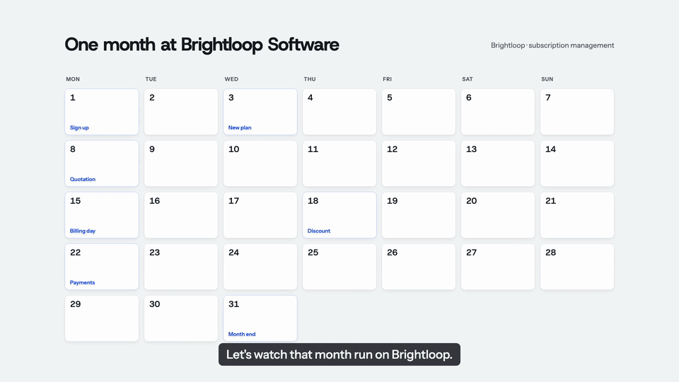

<sub>Built for the <b>Odoo Hackathon</b> problem statement <i>"Subscription Management System"</i>. It follows how Odoo Subscriptions works, built from scratch.</sub>

</div>

---

## Try it

| | |
|---|---|
| 🌐 **Live app** | **https://brightloop-steel.vercel.app** |
| 🏢 **Start** | Register your business at **[/signup](https://brightloop-steel.vercel.app/signup)**. You become its admin. |
| 💳 **Payments** | **Razorpay (test mode):** connect your Razorpay test keys in **Settings → Payments**, then customers pay with Razorpay's real checkout. Choose **Netbanking → Success** on the test bank page, or card `4111 1111 1111 1111`. Without Razorpay, a demo checkout is used (`4242 4242 4242 4242` pays, `4000 0000 0000 0002` is declined). No real money moves. |
| 🧪 **Demo data** | The live site starts empty for real companies. Run it locally with `npm run db:seed` for two demo companies with a year of history ([logins below](#demo-logins)). |

## How it works

<p align="center">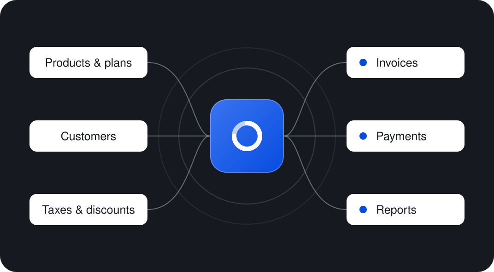</p>

1. **A business registers** and gets its own private workspace. The person who registers is its **admin**.
2. The admin sets up **products, plans, taxes and discounts**, invites **staff**, and connects the company's **own email**.
3. Staff add **customers**. Each one is emailed a one-time link to set a password and use the **customer portal**.
4. Quotations become **subscriptions**. On **billing day** invoices create, confirm and email themselves, discounts
   apply on their own, and **payments** (online or recorded by the team) mark them paid.
5. The **dashboard and reports** show active subscriptions, recurring revenue, what came in and what's overdue.

Every company's data is completely separate. One company can never see or change another's records.

## Contents

- [Features](#features)
  - [Companies, team and roles](#-companies-team-and-roles)
  - [Products, variants and plans](#-products-variants-and-plans)
  - [Quotations and subscriptions](#-quotations-and-subscriptions)
  - [Billing day: invoices, taxes and email](#-billing-day-invoices-taxes-and-email)
  - [Discounts](#-discounts)
  - [Payments](#-payments)
  - [Customer portal](#-customer-portal)
  - [Dashboard and reports](#-dashboard-and-reports)
  - [Email that comes from the company](#-email-that-comes-from-the-company)
  - [Security and data isolation](#-security-and-data-isolation)
- [Every requirement in the brief](#every-requirement-in-the-brief)
- [Architecture](#architecture)
- [Getting started](#getting-started)
- [Deploying](#deploying-vercel--neon)
- [Tests and performance](#tests-and-performance)
- [Project structure](#project-structure)

---

## Features

### 🏢 Companies, team and roles

<table><tr>
<td width="50%">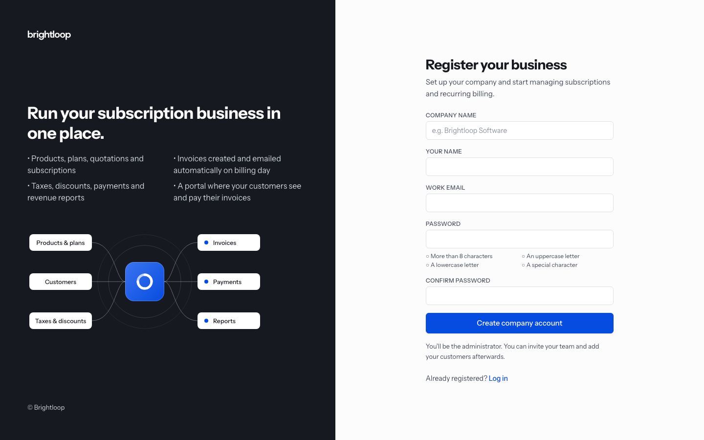</td>
<td width="50%">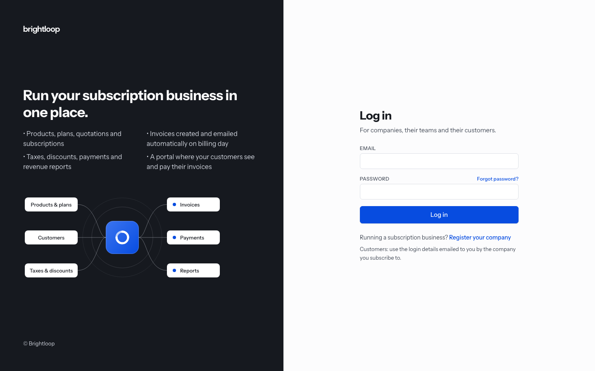</td>
</tr></table>

- **Any business can register**: company name, owner, email and password. It gets a workspace with default GST
  taxes, payment terms and close reasons, and a **Get started** checklist.
- **Password rules** from the brief: **more than 8 characters**, with an uppercase letter, a lowercase letter and a
  special character, shown live as you type. **One account per email.**
- **Forgot password** emails a **one-time reset link** that expires after an hour.
- **Three roles** per company, checked on the server for every request:

  | Role | Can do |
  |---|---|
  | **Admin** | Everything: settings, products, plans, taxes, **discounts**, team |
  | **Internal staff** | Day-to-day work: customers, quotations, subscriptions, invoices, payments, reports |
  | **Customer** | Only their own subscriptions, invoices and payments, in the portal |

- **Only the admin can add staff.** They're invited by email and set their own password.
- **Customers don't sign up.** Staff add them, and they get a login link by email (or staff share it by hand).

### 📦 Products, variants and plans

<table><tr>
<td width="50%">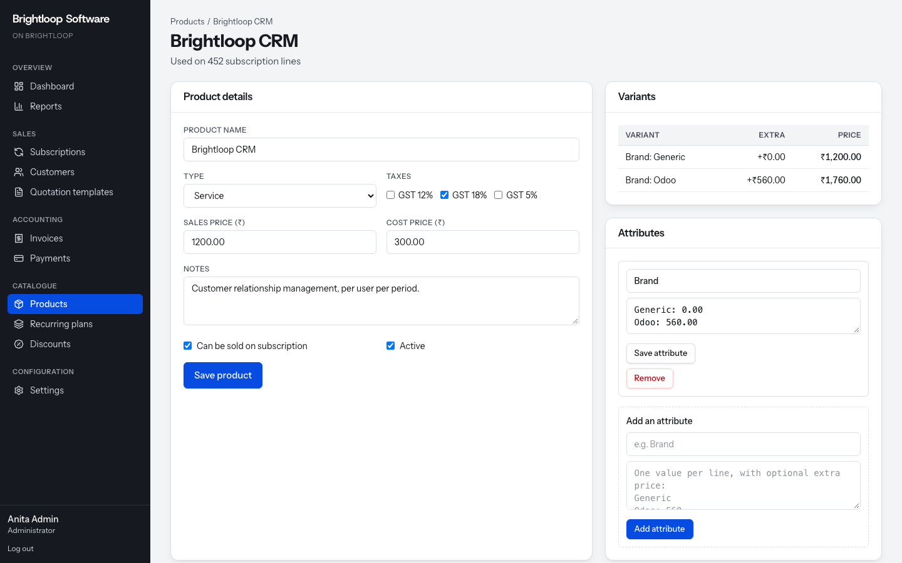</td>
<td width="50%">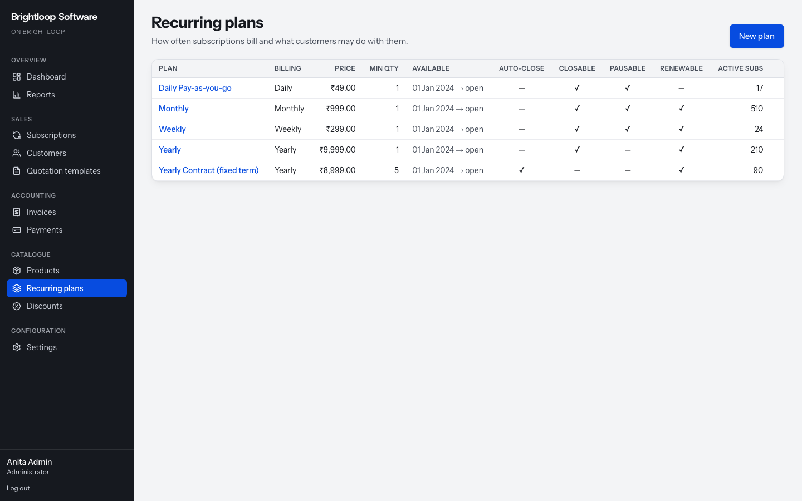</td>
</tr></table>

- **Products**: name, type (service, add-on, goods), sales price, cost price, notes and taxes.
- **Variants** from attributes whose values add to the price, such as **Brand: Odoo → +₹560** (the brief's example).
  Every combination becomes a variant automatically.
- **Recurring plans**: price and how often they bill (**daily, weekly, monthly, yearly**, or every N periods), the
  **minimum quantity**, the **dates the plan is available**, and per-plan rules: **closes automatically**, **can be
  closed early**, **can be paused**, **can be renewed**.

### 📝 Quotations and subscriptions

<table><tr>
<td width="50%">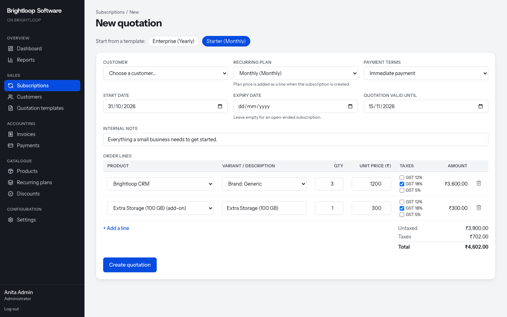</td>
<td width="50%">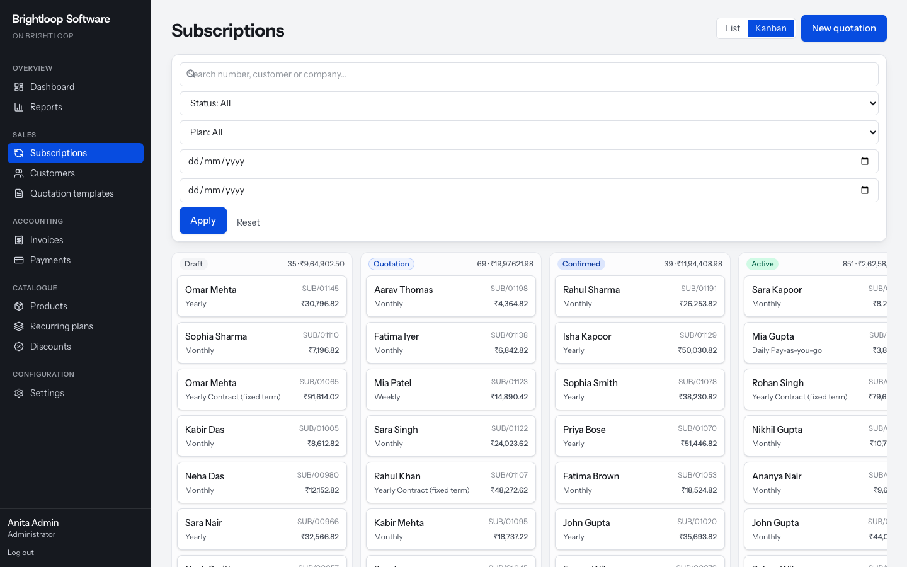</td>
</tr><tr>
<td colspan="2">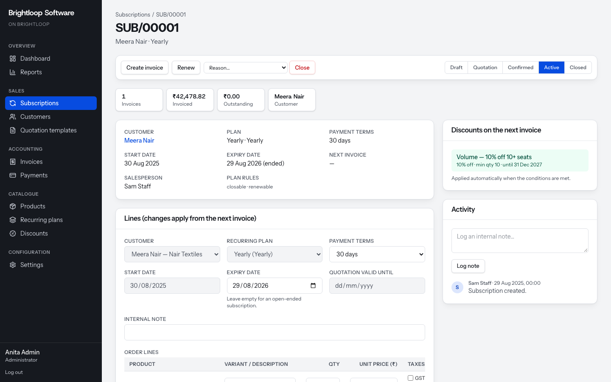</td>
</tr></table>

- **Quotation templates** with a plan, product lines and a validity in days: **one click** fills a new quotation.
- Each subscription has a **number**, customer, plan, start and expiry date, payment terms, and lines with
  **product, quantity, unit price, taxes and amount**, with totals worked out live.
- An Odoo-style **status bar**, **list and Kanban** views, **smart buttons** (invoices, invoiced, outstanding) and a
  **chatter** recording who did what.
- Send the quotation, confirm, start, pause, resume, renew, upsell, or close with a reason. The plan's rules decide
  what's allowed.

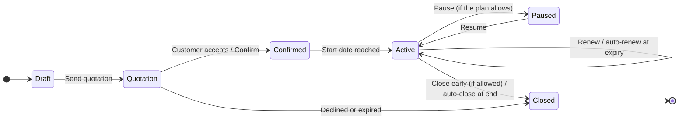

### 🧾 Billing day: invoices, taxes and email

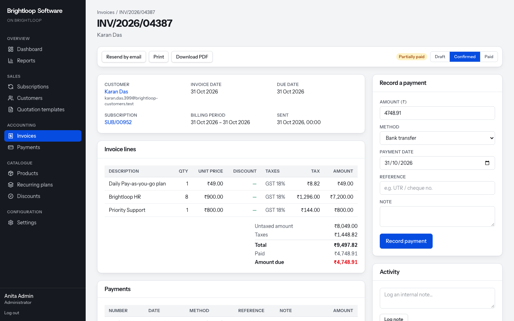

- A **daily job** invoices every subscription that's due: customer details, lines, **taxes**, **discounts** and totals
  are filled in from the subscription. Nobody types an invoice.
- Invoices move **Draft → Confirmed → Paid** (or Cancelled), with *Partially paid* and *Overdue* labels. The team can
  **confirm, cancel, send by email or print / download the PDF**. Confirmed invoices are locked.
- **Never billed twice:** a unique key per subscription and billing period is enforced by the database.
  **Never skipped:** missed periods are caught up on the next run.
- **Taxes** come from rules the admin sets (rate, included in or added to the price).
- **Reminders** go out automatically for overdue invoices and before yearly plans renew.

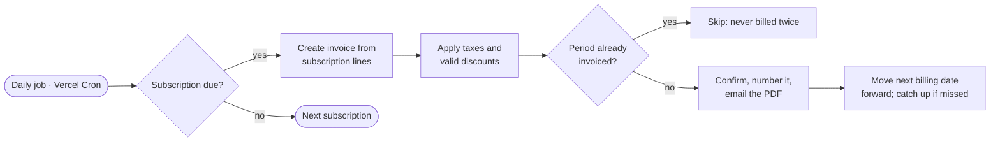

### 🏷️ Discounts

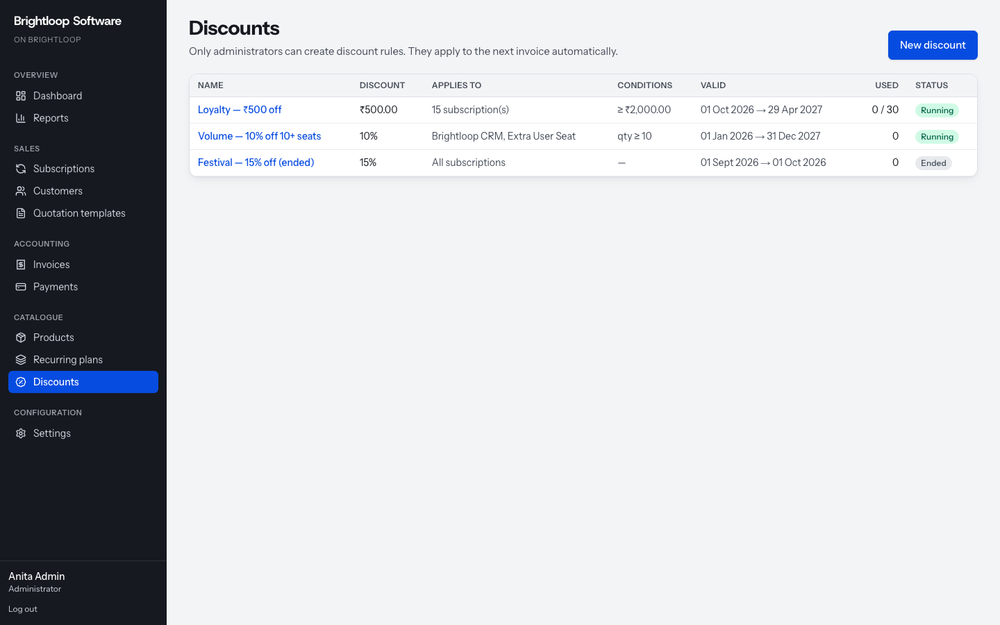

- **Only admins** create discount rules: **fixed amount or percentage**, a **minimum purchase or quantity**, **start
  and end dates**, and a **limit on how many times** it can be used.
- Applies to **specific products** or to **whole subscriptions**.
- It shows up on the **next invoice by itself** and **stops** when it expires or runs out.

### 💳 Payments

<table><tr>
<td width="50%">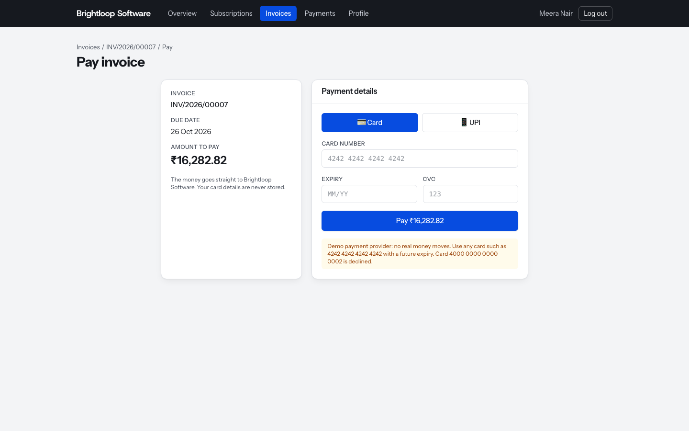</td>
<td width="50%"></td>
</tr></table>

- Payments are recorded with their **method, amount, date, reference and note**, against the right invoice.
- **Part payments** are tracked until the invoice is fully paid. Every payment emails a receipt.
- **Customers pay online with Razorpay** (test mode): each company connects **its own Razorpay keys** in **Settings →
  Payments** (checked with Razorpay, stored encrypted, test keys only), so the money goes to the company's account.
  Customers get Razorpay's real checkout (card, UPI, netbanking). Before anything is recorded, the server **verifies
  Razorpay's signature**, confirms the order and amount belong to that invoice, and captures the payment. The same
  Razorpay payment can never be recorded twice.
- Companies that haven't connected Razorpay get a **demo checkout** (like Odoo's *Demo* provider).
- The team sees at a glance what's **paid, outstanding and overdue**.

### 👤 Customer portal

<table><tr>
<td width="62%">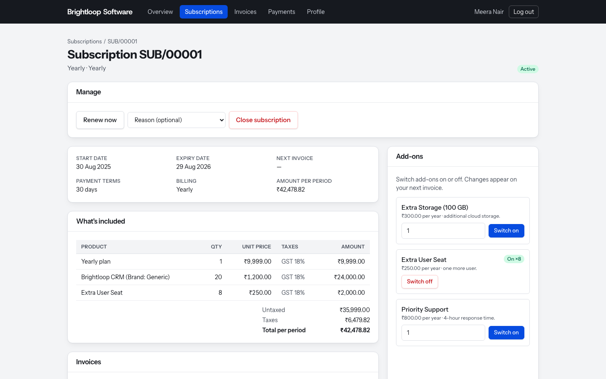</td>
<td width="38%">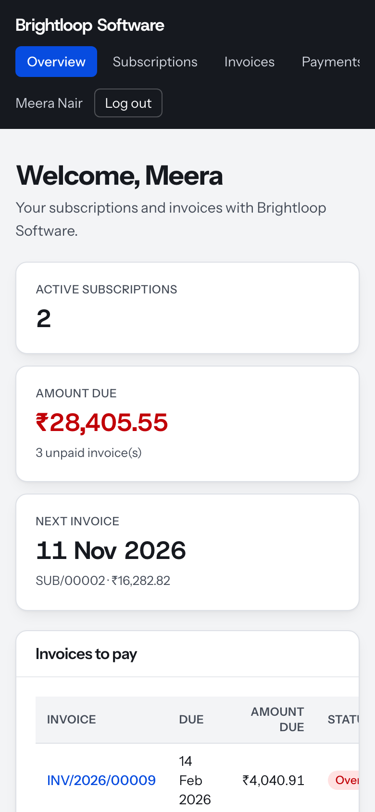</td>
</tr></table>

- Customers see **only their own** subscriptions, invoices and payments, on desktop or phone.
- **Accept or decline quotations**, **switch add-ons on and off**, and pause, renew or close when the plan allows.
- **Pay now**, download invoice PDFs, see payment history, and update their profile and password.

### 📊 Dashboard and reports

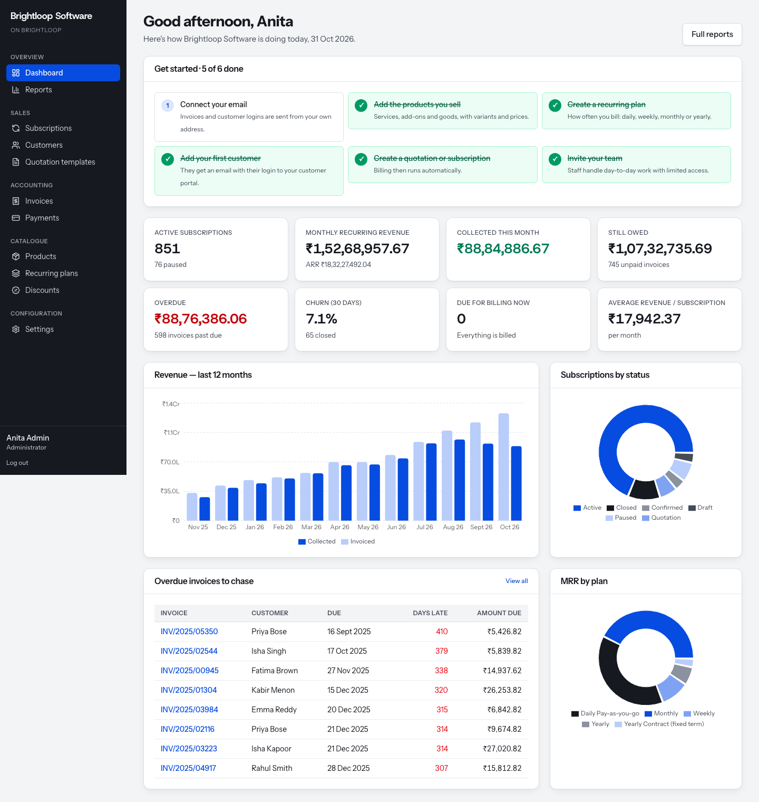

<table><tr>
<td width="50%">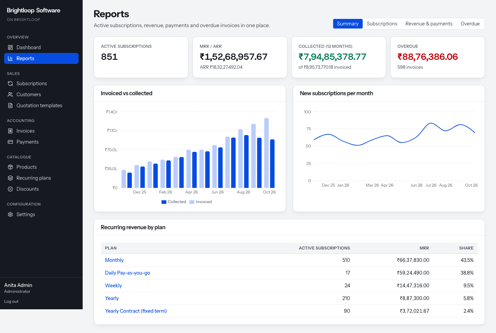</td>
<td width="50%">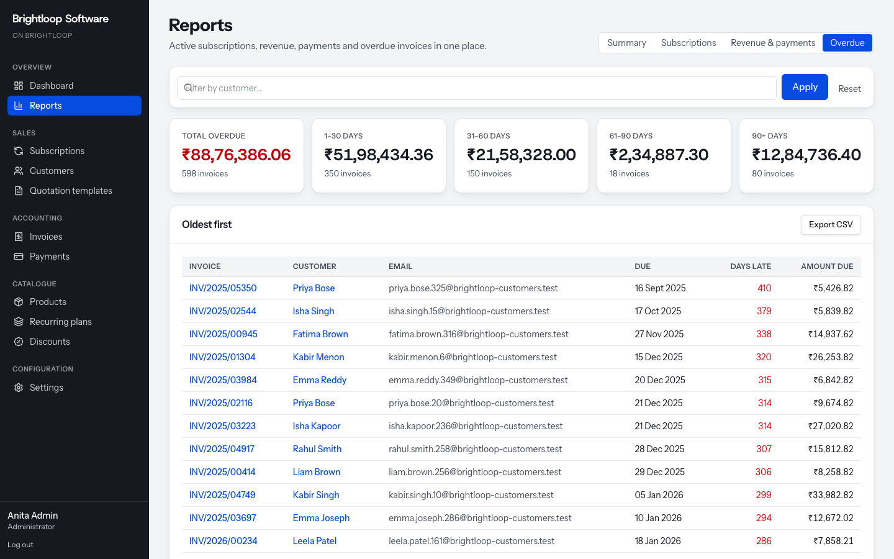</td>
</tr></table>

- **Active subscriptions, monthly and annual recurring revenue (MRR/ARR), collected this month, still owed, overdue**
  and churn, with a **12-month revenue chart** (invoiced vs collected).
- Reports by **status and plan**, **revenue and payments by method and date range**, and **overdue ageing**
  (1–30, 31–60, 61–90, 90+ days), each with filters and **CSV export**.

### ✉️ Email that comes from the company

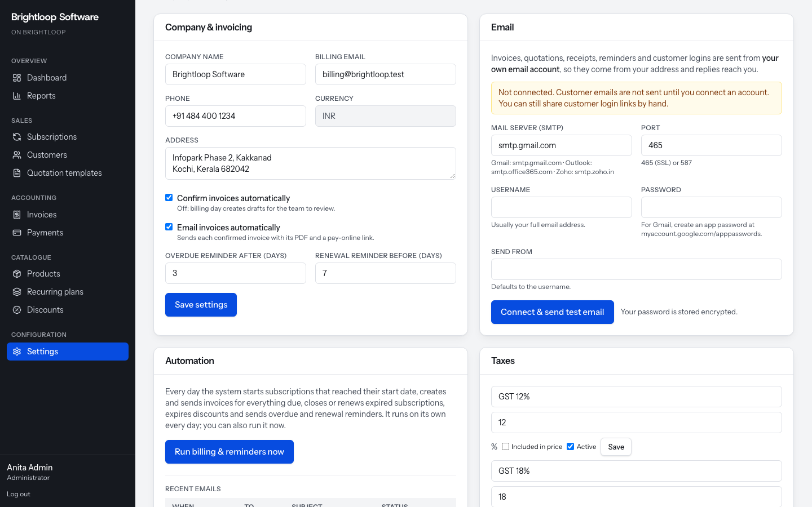

- Each company connects **its own email account** (for example a Gmail app password). The connection is tested and a
  test email is sent before saving, and the password is **stored encrypted** (AES-256-GCM).
- Logins, quotations, invoices with PDFs, receipts and reminders go out **from the company's address**, so replies
  reach the company. Until it's connected, nothing is sent on its behalf, and staff can share login links by hand.
- The platform's own sender is used only for password resets, welcome emails and staff invitations, with daily caps.

### 🔐 Security and data isolation

- **One company can never see another's data.** Every database query goes through a client scoped to the logged-in
  user's company, in one central place. IDs coming from forms are checked to belong to that company, and the database
  refuses any record without a company.
- **Passwords** are hashed with bcrypt, **sessions** are random tokens stored hashed, and reset and invite links are
  **one-time** and expire.
- **Rate limits:** logins pause after 8 failed attempts per email for 15 minutes, password-reset emails are capped
  at 5 per hour, and each network can register at most 5 companies per hour.
- **Money** is stored as whole paise, so there are no rounding errors.

---

## Every requirement in the brief

| Scene in the brief | Requirement | ✓ |
|---|---|---|
| A new customer signs up | Email + password; **one account per email**; password **more than 8 chars** with upper, lower and special | ✅ |
| | **Reset link** to the registered email | ✅ |
| | **Admin** controls everything, **staff** have limited access, **customers** see only their own data in a **portal** | ✅ |
| | **Only the admin** can add staff | ✅ |
| Launching a new plan | Product **name, type, sales price, cost price, notes** | ✅ |
| | **Variants**, e.g. Odoo brand **+560** | ✅ |
| | Plan price; **daily, weekly, monthly or yearly**; **minimum quantity**; **availability dates** | ✅ |
| | Per plan: **close on its own**, **closed early**, **paused**, **renewed** | ✅ |
| Turning a quote into a subscription | **Quotation templates** with plan and lines, **valid for N days** | ✅ |
| | **Number, customer, plan, start date, expiry date, payment terms**; lines with **product, qty, unit price, taxes, amount** | ✅ |
| | **Draft → Quotation → Confirmed → Active → Closed**, visible to the whole team | ✅ |
| Billing day | Invoices **created from the subscription** with customer, lines, taxes and totals | ✅ |
| | **Taxes calculated automatically** from the admin's rules | ✅ |
| | **Confirm, cancel, send, print**; **Draft → Confirmed → Paid** | ✅ |
| | **Nothing billed twice or skipped** | ✅ |
| A customer asks for a better price | **Admin-only** discount rules: **fixed or %**, **min purchase or qty**, **dates**, **usage limit** | ✅ |
| | On **products or whole subscriptions**; **appears on the next invoice** and **stops** when expired or used up | ✅ |
| The money comes in | Payments with **method, amount, date and note** against the right invoice | ✅ |
| | See **paid vs outstanding**, chase **overdue** | ✅ |
| The finance lead | **Active subscriptions, revenue, payments, overdue** with **filters and a summary view** | ✅ |
| | **Thousands of subscriptions**, every page **under two seconds** | ✅ |

---

## Architecture

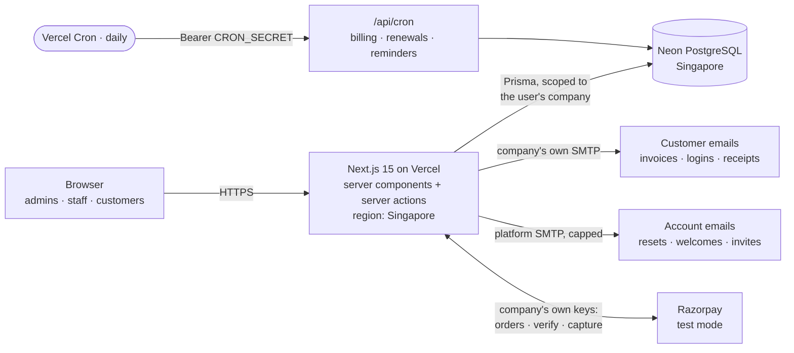

| Layer | Choice |
|---|---|
| App | **Next.js 15** (App Router, server components, server actions), **TypeScript** |
| Data | **PostgreSQL** with **Prisma**: Docker locally, **Neon** in production |
| UI | **Tailwind CSS 4**, Host Grotesk + Instrument Sans, **Recharts**, lucide icons |
| Payments | **Razorpay** Orders + Checkout (test mode), per-company keys, server-side signature verification |
| Email and PDFs | **Nodemailer** (each company's SMTP + a capped platform sender), **pdf-lib** |
| Hosting | **Vercel**, functions pinned next to the database, **Vercel Cron** for daily billing |
| Tests | Node's test runner (unit + integration) and **Playwright** (end-to-end) |

---

## Getting started

```bash
git clone https://github.com/asil-eng/brightloop.git
cd brightloop
npm install
cp .env.example .env

# Local PostgreSQL (matches the URLs in .env.example)
docker run -d --name brightloop-pg -e POSTGRES_USER=brightloop -e POSTGRES_PASSWORD=brightloop \
  -e POSTGRES_DB=brightloop -p 5433:5432 postgres:16-alpine

npx prisma migrate deploy   # create the tables
npm run db:seed             # optional: two demo companies with a year of history
npm run dev                 # http://localhost:3000
```

Without the seed, the system starts empty and the first company registers at `/signup`. The seed deletes all data and
refuses to run against anything but a local database.

### Demo logins

The seed creates two companies, so you can see that their data is kept apart.

| Company | Role | Email | Password |
|---|---|---|---|
| **Brightloop Software** (~1,200 subscriptions) | Admin | `admin@brightloop.test` | `Admin@1234` |
| | Internal staff | `staff@brightloop.test` | `Staff@1234` |
| | Customer (portal) | `customer@brightloop.test` | `Customer@123` |
| **Nimbus Fitness** (~200 subscriptions) | Admin | `admin@nimbusfitness.test` | `Admin@1234` |
| | Internal staff | `staff@nimbusfitness.test` | `Staff@1234` |
| | Customer (portal) | `customer@nimbusfitness.test` | `Customer@123` |

For a bigger dataset: `SEED_SUBSCRIPTIONS=5000 npm run db:seed`. In development, emails that can't be sent (no SMTP
configured) are printed in the terminal running `npm run dev`, including customers' login links.

---

## Deploying (Vercel + Neon)

1. **Database:** create a project on [Neon](https://neon.tech) and copy the **pooled** (`DATABASE_URL`) and **direct**
   (`DIRECT_URL`) connection strings.
2. **Vercel:** import the repo at [vercel.com/new](https://vercel.com/new). The build (`npm run vercel-build`) applies
   database migrations, then builds the app. Every push to `main` redeploys.
3. **Environment variables** (Vercel → Settings → Environment Variables):

   | Variable | Value |
   |---|---|
   | `DATABASE_URL`, `DIRECT_URL` | Neon pooled and direct connection strings |
   | `CRON_SECRET` | any long random string (protects the daily billing job) |
   | `EMAIL_ENCRYPTION_KEY` | any long random string (encrypts companies' email passwords; never change it later) |
   | `SMTP_HOST`, `SMTP_PORT`, `SMTP_USER`, `SMTP_PASS`, `MAIL_FROM_ADDRESS` | platform sender for account emails |
   | `PLATFORM_EMAIL_DAILY_LIMIT` | optional cap on platform emails per day (default 200) |
   | `APP_URL` | optional custom domain, e.g. `https://billing.example.com` |

4. **Daily billing:** `vercel.json` schedules Vercel Cron to call `/api/cron` at 00:30 UTC for every company. Admins can
   also click **Settings → Run billing & reminders now**. Running with `npm run dev` or `npm start`, an in-app
   scheduler runs the same jobs every hour.

`vercel.json` also pins the functions to Singapore (`sin1`), next to the Neon database, so each query takes about a
millisecond instead of crossing an ocean.

---

## Tests and performance

```bash
npm test            # 23 unit + integration tests (separate brightloop_test database)
npm run test:e2e    # 7 Playwright browser tests against the seeded dev database
npm run typecheck && npm run lint
```

- **Billing engine:** no double billing, catching up on missed periods, discount usage limits, part payments,
  cancel-and-rebill, pause stopping billing, auto-close vs auto-renew, and plan rules.
- **Isolation:** another company can't read, list, total, update or pay a company's records; numbering is per
  company; records can't exist without a company.
- **Email:** passwords encrypted and tamper-proof; customer emails never fall back to the platform sender.
- **Razorpay:** checkout results are only trusted with a valid signature; only test keys are accepted. A full payment
  through Razorpay's test checkout (netbanking → Success) was verified end to end.
- **End to end:** company registration, forgot password, staff adding a customer who sets a password from the emailed
  link, template → quotation → active subscription → invoice, online payment (declined, then approved), add-ons,
  part payments, cross-company access blocked, and login lockout.

**Performance:** with **5,000 subscriptions, 23,000 invoices and 20,000 payments**, every page responds in **under
0.15 s** in production mode on a laptop (target: under 2 s). Lists are paginated, filtered columns are indexed, and
totals are calculated in the database. On the live site, moving between sections takes about 0.2–0.8 s.

---

## Project structure

```
prisma/
  schema.prisma          data model (every company-owned table carries orgId)
  seed.ts                two demo companies with a year of history
src/
  lib/
    db.ts                rootDb + scopedDb(orgId): the company-scoped database client
    pricing.ts           taxes and discounts (pure functions)
    billing.ts           invoice generation, payments, renewals
    subscriptions.ts     subscription lifecycle (confirm, pause, resume, close…)
    jobs.ts              daily jobs: billing run, expiry, reminders
    company.ts           company registration (workspace + admin + defaults)
    portal-access.ts     customer login emails (one-time set-password link)
    mail.ts, pdf.ts      email (company / platform senders) and invoice PDFs
    razorpay.ts          Razorpay orders, signature checks and capture
    secret-box.ts        AES-256-GCM for companies' email passwords and Razorpay secrets
    rate-limit.ts        login, reset and registration limits
    metrics.ts           MRR/ARR, revenue and dashboard numbers
  app/
    (auth)/              login, company registration, forgot/reset password
    app/                 back office (admin + staff)
    portal/              customer portal
    api/                 invoice PDF, CSV reports, cron
  components/            UI kit, line editor, chatter, charts
tests/                   unit + integration tests
e2e/                     Playwright tests
docs/                    README screenshots and diagram
```

<details>
<summary><b>Data model</b></summary>

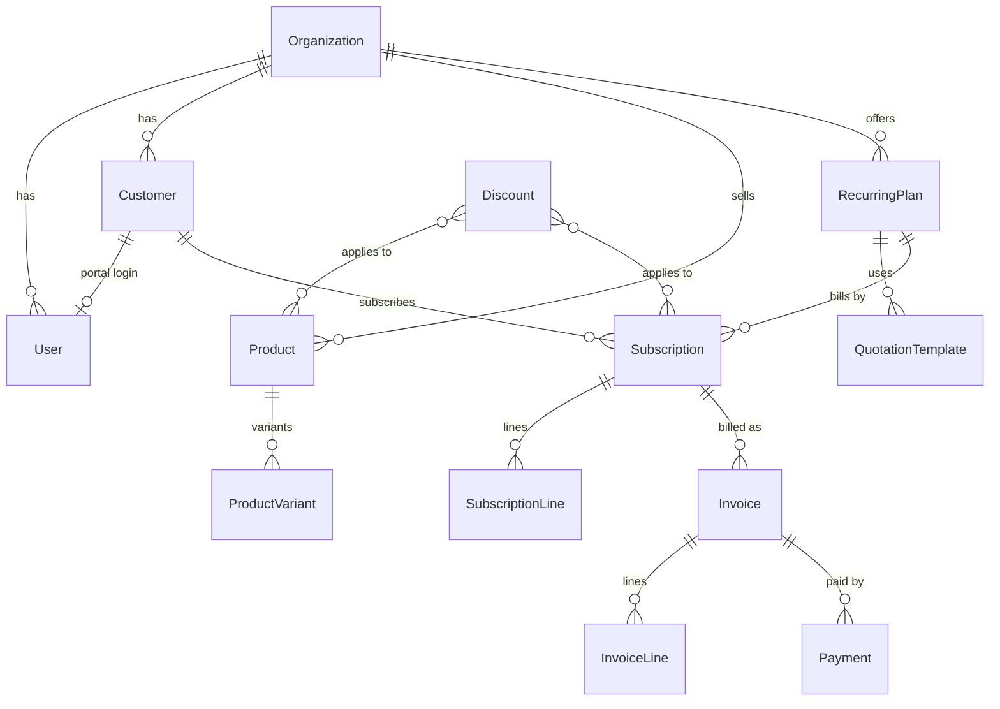

Also: `Tax`, `PaymentTerm`, `CloseReason`, `Attribute` / `AttributeValue`, `TemplateLine`, `Activity` (chatter),
`EmailLog`, `Sequence` (per-company document numbers), `Session`, `PasswordResetToken`, `RateLimitHit`.

</details>

---

<div align="center">
<sub>Built for the Odoo Hackathon · <a href="https://brightloop-steel.vercel.app">brightloop-steel.vercel.app</a></sub>
</div>
